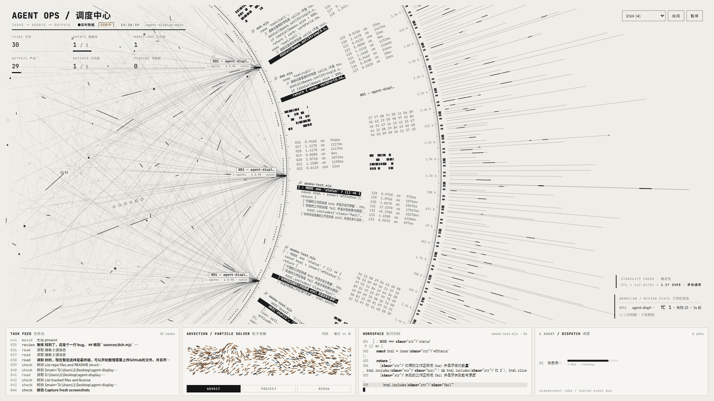
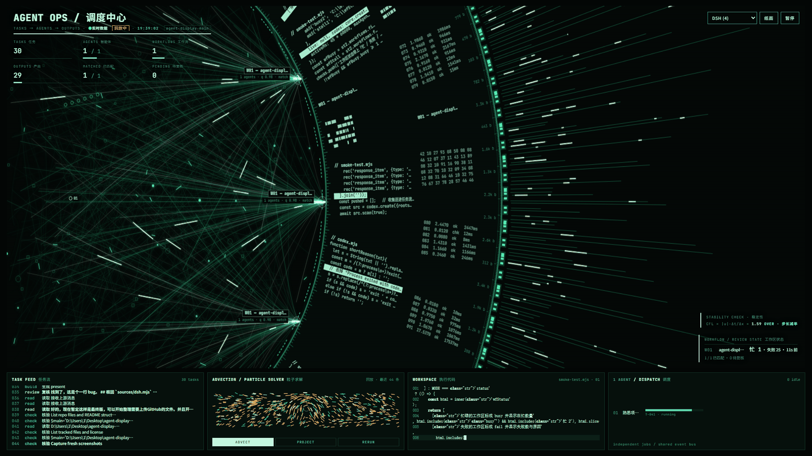
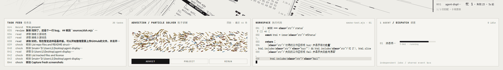

# Agent Ops · 调度大屏

把本机正在跑的 AI 智能体会话，画成一块**能用来判断问题**的调度大屏。

哪一个工作区在忙、哪里刚失败、哪个卡了 15 分钟没动静——不用翻日志，抬眼就能看到。





> 两套主题，右上角一键切换（默认跟随系统深浅色）。
> 截图里的每一个数字、每一行代码、每一条谱线都来自真实的会话日志，没有任何随机假动画。

**当前版本：v3.2.2**（2026-10-22）· [变更记录](CHANGELOG.md) · 27 个测试模式 / 997 项断言

---

## 1. 这是一个什么项目

一个**纯前端 + 一个本地 Node 服务**的可视化大屏，不依赖框架、不需要构建：

- `index.html` 一个文件装下全部界面和动画（HTML + CSS + Canvas）
- `dsh-bridge.mjs` 一个只读的本地服务，把磁盘上的 agent 会话日志整理成接口
- 浏览器访问 `http://127.0.0.1:8778` 就能看

它想回答三个问题，而不是"看起来很酷"：

| 问题 | 在屏幕上的位置 |
|---|---|
| **哪个工作区正在忙？** | 右下角工作区状态表的「忙 N」，以及粒子面板里对应泳道的粒子密度 |
| **哪里失败了？** | 状态表里标红的工作区 + `↳ 工具 · 错误原因`，任务流里带 `✕` 的红色行 |
| **多久没有进展？** | 状态表里的「多久前」；超过 5 分钟没活动直接标成**停滞** |

顶栏同时显示三类信息：**连接健康**（`实时数据` 绿 / `数据中断 Ns` 红）、**采集健康**（`采集正常` / `采集降级 · 使用缓存` / `缓存可能过期`，并给出距最后一次成功采集的时间）与**数据性质**（`live` 真实数据 / `演示数据` 黄，demo 后端或内置演示，带水印，即使联网也不会变成实时）。用户主动暂停时显示 `暂停中 · 数据冻结`；空闲回放时多一个 `回放中` 标签；系统开启「减少动效」时单独标注 `减少动效 · 数据仍实时`（只关动画，不冻结数据）。

---

## 2. 各个部分的介绍



### 顶部指标

| 区域 | 是什么 |
|---|---|
| TASKS / AGENTS / WORKFLOWS | 任务记录数、在跑智能体数 / 上限、工作区数 |
| DONE / RATE OK / RATE LOW | 已完成任务记录数；成功率达标 / 低于阈值的工作区数（无样本单列「暂无调用」，口径见 §7.5） |

### 左侧：工作流与智能体

| 区域 | 是什么 |
|---|---|
| 工作流节点 | 一个工作区一个节点（最多 5 个，超过的靠轮换显示）：工作区名 + 工具调用成功率 + 该区智能体数 |
| 智能体节点 + 连线 | 一个会话一个点；`Lead → 子智能体` 的边来自会话里真实的父子关系。**连线始终保留**；只有目标智能体有任务在跑时才有沿线流动的亮点，空闲/已退出只有静态线（与左侧工作区「有任务才有流入」同一口径） |
| 点击 / 悬浮节点 | 工作流节点悬浮显示完整目录名、运行中数量与成功率；工作区/智能体列表行有「详情」按钮，点开右侧可停留详情侧栏（完整名称、来源、当前调用、持续时间、最后活动、完整错误），支持复制与 Esc 关闭、焦点返回；画布上的智能体节点也可点击打开同一详情 |

### 中间：数据飞轮

| 区域 | 是什么 |
|---|---|
| 旋转环带 · 代码块 | 真实被写进文件的代码，表头就是文件名 |
| 旋转环带 · 表格块 | 真实工具调用的耗时，失败标 `chk` |
| 旋转环带 · 标签块 | 真实工作区名 |
| 外射谱线 | 每条 = 一个真实事件，长度 = 它与上一条之间的间隔 |
| 外圈字节标签 | 工具调用入参的真实字节数 |
| 扫光 / 齿环转速 | 每来一批新事件扫一次；转速 = 真实事件速率 |

### 底部：四个面板

| 面板 | 是什么 |
|---|---|
| **TASK FEED · 任务流** | 真实对话 + 工具调用，按会话分组，滚轮可往上翻已加载的历史；失败行带 `✕` 并标红 |
| **ADVECTION / PARTICLE SOLVER · 粒子回答** | **一个粒子 = 一条真实事件**；见下文 |
| **WORKSPACE · 执行代码** | 最近被写入的代码，带文件名和行号 |
| **DISPATCH · 调度** | 当前在跑的智能体，以及它此刻的任务 |

### 粒子面板怎么读

| 现象 | 含义 |
|---|---|
| 粒子从左往右游 | 工具调用正常推进（左 = 任务，右 = 产出） |
| 每条泳道标 `W01`/`W02`… | 一个工作区一条泳道；超过 4 个工作区时最后一条标 `W04+`，表示合并泳道 |
| 某一列在打转 | **同一个智能体的连续调用**——它在这个位置反复做事，形成漩涡 |
| 粒子往左倒流 | **这条调用失败了**（`ok:false`），反向回流 |
| 密度 | 该工作区的事件量；哪条流密，就是哪里在忙 |
| 右上角「回放 · 最近 N 条」 | 超过 3 秒没有新事件，就循环回放最近 200 条真实事件 |

> 粒子的**生成时机、泳道、流向、颜色、粗细、密度**全部来自真实事件；
> 唯一的视觉修饰是泳道内的轻微上下摆动和鼠标点击产生的涡流，它们不改变"往右流"这个主方向。

### 右下角：工作区状态

```
WORKFLOW / REVIEW STATE 工作区状态
W01  agent-displ…   忙 1 · 失败 25 · 5s 前
                    ↳ edit · Error: cannot edit "..."
W03  stall-wf       停滞 15m
```

- **忙 N**：该工作区里正在跑的会话数
- **失败 N**：累计失败调用数；10 分钟内有失败会标红，并显示最近一次的 `工具 · 错误原因`
- **多久前**：距最后一次活动的时间；超过 5 分钟判为**停滞**（即使还挂着未完成调用也不会显示成忙）

---

## 3. 接入了什么数据

从**本机磁盘上真实的 agent 会话日志**里读，不联网、不上传、不改原文件：

| 数据源 | 读取位置 | 说明 |
|---|---|---|
| **DSH**（DeepSeek Harness） | `~/.dsh/sessions/<工作区>/<会话>/session.v4.jsonl.zstd` | zstd 压缩，需要 Node 23.8+ |
| **Codex**（OpenAI Codex CLI / Desktop） | `~/.codex/sessions/**`、`~/.codex/archived_sessions/**`；新版 Desktop 另读 `~/.codex/state_5.sqlite` + `~/.codex/thread_history_1.sqlite`（JSONL 只在回合边界落盘，实时状态在 SQLite） | Node 18+（SQLite 读取需 22.5+） |
| **Claude Code** | `~/.claude/projects/<工作区>/<sessionId>.jsonl` | Node 18+ |

从日志里解析出来的东西：

- **会话**：工作目录、开始时间、父会话（`Lead → 子智能体` 的层级）
- **工具调用**：工具名、入参、耗时、成功 / 失败、失败原因
- **对话**：用户消息、助手回复
- **写入的代码**：`write` / `edit` 类调用实际写进文件的内容
- **事件流**：每来一条新事件就推给前端，用来驱动环带、谱线和粒子

支持同时装多个源，右上角下拉切换，也可以 `?source=all` 合并上墙。

**一个源都没装也能看**：页面会自动进入演示模式（内置假数据 + 水印）；`server.mjs` 演示后端同样标记 `dataKind=demo`。演示数据即使持续联网也不会被显示成实时数据。

---

## 4. 使用说明

### 4.1 装 Node.js

从 <https://nodejs.org> 装 Node.js。**推荐 Node 24**（本次实测版本）；最低可跑 Node 18，能力按版本降级：

| 能力 | 要求 | 低于要求时 |
|---|---|---|
| 基础服务 + Claude + JSONL | Node 18+ | — |
| Codex SQLite（实时状态） | Node 22.5+（`node:sqlite`） | SQLite 源标记 `absent`/`unsupported`，JSONL 部分照常，不报故障 |
| DSH zstd 会话 | Node 23.8+（`zlib.zstd*`） | DSH 源显示不可用，另外两个源照常 |
| 完整 27 模式回归（`run-all-tests.mjs`） | 建议 Node 24 | 缺能力的模式按既有逻辑跳过/降级，汇总会说明 |

> 能力缺失是**预期降级**，不是读取故障：`stale` 不会因此变真，`dataKind` 与连接健康也不受影响。

### 4.2 拿到代码

```bash
git clone <仓库地址>
cd agent-display
```

或者直接下载 ZIP 解压。

### 4.3 启动

**Windows**：双击 `start.cmd`，它会起服务并自动打开浏览器。

**macOS / Linux**（或想手动控制）：

```bash
node dsh-bridge.mjs
```

然后打开 <http://127.0.0.1:8778>。

> ⚠️ **不要直接双击 `index.html`。**
> 浏览器在 `file://` 下禁止读取本地数据，双击只会看到一张提示卡片（卡片上有启动说明）。
> 必须通过本地服务打开。

### 4.4 停止

关掉那个黑窗口，或者双击 `stop.cmd`。

`stop.cmd` 先用同一个 `PORT`（默认 8778）通过 HTTP 询问该端口服务的 `servedFrom` / `epoch`：
只有 `servedFrom` 等于本目录名、且有 `epoch` 时才停止对应进程；不一致或认不出身份就明确报错，
**不会**只凭 PID / 命令行里含有 `dsh-bridge.mjs` 去杀进程。设置了 `TOKEN` 时会带上令牌查询。

> 已知限制：`servedFrom` 只是目录名，两个**同名目录**的实例无法仅凭它区分。这种情况请给它们不同的
> `PORT`，或从各自的控制台窗口关闭。

### 4.5 页面操作

| 操作 | 效果 |
|---|---|
| 右上角下拉框 | 切换数据源 |
| 右上角 `夜间` / `纸面` | 切换主题 |
| 右上角 `暂停` | 冻结画面（动画和刷新都停，方便截图） |
| 鼠标悬停 | 智能体节点 / 环带块 / 谱线的详情 |
| 在粒子面板上点击 | 在点击处加一个涡流（纯视觉） |
| 滚轮停在任务流上 | 往上翻已经加载的历史（面板里保留最近约 120 条，内存里最多 400 条）；**不会**再向后端拉更早的记录；滚离底部后出现「↓ 最新」按钮 |

---

## 5. 用户自己切换数据源

### 5.1 三种切换方式

- **右上角下拉框**：会显示每个源有多少会话，例如 `Codex (3)`
- **URL 参数**：`?source=codex`、`?source=claude`、`?source=dsh`、`?source=all`
- **默认源**：`SOURCE=codex node dsh-bridge.mjs`

`?source=all` 会把三家合并上墙，智能体状态行前面带来源角标：`D·` / `C·` / `X·`。

### 5.2 指定读取位置

路径都能用环境变量覆盖（`~` 会展开成用户目录；`CODEX_SESSIONS` 支持多个目录，用系统分隔符隔开）：

| 变量 | 默认 | 多目录 |
|---|---|---|
| `DSH_SESSIONS` | `~/.dsh/sessions` | — |
| `CODEX_SESSIONS` | `~/.codex/sessions` + `~/.codex/archived_sessions` | ✅ `;` 分隔 |
| `CLAUDE_PROJECTS` | `~/.claude/projects` | — |

```bash
# 例：指向 D 盘上的备份，不动原来的日志
CODEX_SESSIONS='D:\backup\codex\sessions;D:\backup\codex\archived_sessions' \
DSH_SESSIONS='D:\backup\dsh\sessions' \
node dsh-bridge.mjs
```

启动日志会逐个列出每个源**实际读的路径**；一旦用了环境变量，还会多打一行
`路径由环境变量覆盖: ...`。

### 5.3 其它启动参数

| 变量 | 默认 | 作用 |
|---|---|---|
| `PORT` | `8778` | 监听端口；`PORT=0` 时由系统分配，日志里的地址会使用实际端口（仅适用于直接运行 `node dsh-bridge.mjs`；`start.cmd` / `stop.cmd` 会明确拒绝 `PORT=0`，因为脚本无法预知实际端口） |
| `ACTIVE_MIN` | `45` | 多少分钟内活动过的会话还留在墙上；必须是 0.001–525600 的有限数 |
| `MAX_AGENTS` | `12` | 一屏最多放几个智能体，多出来的显示成 `+N`；范围 **1–99**，非法值或超出编号容量会明确报错并退出 |
| `SOURCE` | 自动 | 默认数据源 |
| `OPEN` | 关 | `OPEN=1` 时等服务就绪再自动打开浏览器（`start.cmd` 用的就是它） |
| `TOKEN` | 关 | 给 `/api/*` 和首页加访问令牌 |
| `ALLOW_ORIGIN` | 关 | 允许跨域读取的来源，逗号分隔；写 `*` 表示任意来源：预检和实际请求都回 `Access-Control-Allow-Origin: *`，不带凭证。默认一个都不允许 |
| `DEBUG` | 关 | `DEBUG=1` 才开 `/api/agent-ops/debug`（会返回绝对路径） |

```bash
ACTIVE_MIN=900 MAX_AGENTS=8 node dsh-bridge.mjs   # 15 小时内的会话、一屏 8 个
```

**Windows 脚本的端口与令牌**：`start.cmd` / `stop.cmd` 读取同一组环境变量。`PORT` 未设置时默认 8778；脚本在拼接 URL / 传参之前先校验 `PORT` 是十进制 1–65535，非法值明确报错退出，`PORT=0` 也会被拒绝（脚本无法预知实际端口，不能把 0 当已监听端口）。`start.cmd` 打开浏览器用的地址跟随 `PORT`，设置了 `TOKEN` 时自动带上 `?token=`；接管已占用端口前会先核对该实例的 `servedFrom` / `epoch`，认不出就不动它。`stop.cmd` 用同一个 `PORT` 和 `TOKEN` 查询并停止服务，实例身份不一致时明确报错、不杀进程。临时换端口：

```bat
set PORT=8779
start.cmd
```

---

## 6. 隐私与安全

设计前提：**这是给本机看的东西**。

- **只读**：只读取上面那三个目录里的日志，不写、不改、不删。
- **只监听本机**：绑在 `127.0.0.1`，外网连不上。
- **默认不返回 CORS 头**：默认任何网站都读不到这里的接口数据。只有用 `ALLOW_ORIGIN` 显式放行时才会回 CORS 头。配置 `ALLOW_ORIGIN=*` 时，预检和实际请求使用同一策略（都返回 `Access-Control-Allow-Origin: *`，不带凭证）；精确来源仍只放行白名单。
- **挡 DNS rebinding**：校验 `Host` 必须是本机回环，外部域名解析到 127.0.0.1 也读不到。
- **普通接口不返回绝对路径**：`/api/agent-ops/state`、`/api/agent-ops/events`、`/api/sources` 里的工作区身份是**进程级不透明 ID**（`ws:` + 16 位随机十六进制）。服务端内部仍按规范化目录合并/排序；同一进程、同一 `epoch` 内同一目录永远是同一个 ID，不同目录不会混；重启后 `epoch` 变化、ID 重新生成。它不是路径的可猜测哈希 / Base64 / 截断，无法从 ID 反推目录。代码片段只给文件名，`sourceList` 不提供 `path`。
- **调试接口默认关闭**：`/api/agent-ops/debug` 平时返回 404；只有 `DEBUG=1`（且通过令牌 / Host 校验）时才返回绝对路径等诊断信息。
- **启动日志不打印完整令牌**：设置了 `TOKEN` 时日志只说明「已启用令牌」，访问地址里的 `?token=` 需要自己补。
- **令牌保护首页**：设了 `TOKEN` 之后，连首页本身都要令牌才能打开，不会出现"先拿页面再从 HTML 里抠出令牌"的绕过。
- **加固响应头**：`X-Content-Type-Options: nosniff`、`Referrer-Policy: no-referrer`（避免地址栏 `?token=` 经 Referer 外泄）、`Content-Security-Policy: frame-ancestors 'none'` 与 `X-Frame-Options: DENY`（防点击劫持）。CSP 只限制页面被嵌入，不限制 `script-src` / `style-src`，页面内联脚本、内联样式与 Canvas 不受影响。
- **错误输出最小化**：普通 4xx/5xx 只给稳定错误码，不回显绝对路径、异常堆栈或原始 message；页面/接口路由只接受 `GET` / `HEAD`，其他方法返回 405。
- **不联网**：不向外发送任何数据。页面唯一的外部请求是 Google Fonts（加载失败自动回退系统字体，不影响功能）。
- **不上传**：没有任何遥测。

> 不承诺脱敏的内容：日志正文、代码片段、工具名 / 命令里由用户主动写入的路径属于原始数据，不在「普通接口不返回绝对路径」的元数据契约内。需要隐藏这些内容时请另设内容脱敏模式。

> 如果你要把服务暴露到本机之外（端口转发、局域网共享），务必先设 `TOKEN`，
> 然后用 `http://127.0.0.1:8778/?token=<令牌>` 打开。

---

## 7. 自定义

### 7.1 改配置

所有可改的内容集中在 `index.html` 里 `<script>` 最前面的 `CONFIG`：

```js
const CONFIG = {
  matchThreshold: 0.8,     // 工具调用成功率 ≥ 该值算「达标」
  agents: [...],           // 演示模式下的智能体名
  taskNames: [...],        // 演示模式下的任务名
  workflows: [...],        // 演示模式下的工作流名
  codeSets: [...],         // 演示模式下的示例代码
};
```

> 接上真实数据后这些只在"演示模式"里生效——真实的智能体名、任务名、工作区名都来自日志本身。

### 7.2 改配色 / 节奏

- 配色：`<style>` 顶部的 CSS 变量，`:root`（纸面）、`[data-theme="dark"]`（夜间）
- 飞轮转速：`SPIN`（弧度/秒，默认 `0.16`）
- 刷新间隔：`CONFIG.pollMs`（默认 `1000`）
- 锁主题（看板场景推荐）：`?theme=dark` / `?theme=light`

### 7.3 加一个新数据源

在 `sources/` 下写一个 `create({ activeMs, live })`，返回：

```js
export function create({ activeMs, live }) {
  return {
    id: 'mysource', name: 'My Source', note: '...', path: '/where',
    scan,            // async，读磁盘、更新内部缓存；新事件用 live.push() 送进任务流
    sessions,        // () => 折叠好的会话数组（形状见 sources/dsh.mjs 顶部注释）
    available,       // () => boolean
    stats,           // () => ({ sessions, active, files })
  };
}
```

然后在 `dsh-bridge.mjs` 的 `entries` 里注册一行。前端下拉是从 `/api/agent-ops/state` 的
`sourceList` 自动生成的，**不用改前端**。

### 7.4 自己实现后端

只要满足这三组接口：

```
GET /api/agent-ops/state?source=<id>
GET /api/agent-ops/events?source=<id>&after=<seq>
GET /api/sources
```

返回结构直接看 `lib/core.mjs` 里 `buildState()` 的返回值和 `dsh-bridge.mjs` 的路由。

### 7.5 协议字段与兼容契约

**state**（`GET /api/agent-ops/state?source=<id>`）在原有 `tasks / agents / workflows / links / snippets / ring` 之外新增：

| 字段 | 含义 |
|---|---|
| `protocolVersion` | 当前为 `2`；旧前端可以忽略 |
| `epoch` | 进程代际。重启后变化；前端见 `epoch` 变化就重置游标、任务流、粒子去重与回放 |
| `source` | 本次响应对应的数据源（`dsh` / `codex` / `claude` / `all`） |
| `revision` | 该视图已发布事件的序号水位（与 events 外壳的 `revision` 同义） |
| `dataKind` | 数据性质：真实 bridge 恒为 `live`；`server.mjs` 演示后端恒为 `demo`。它与「连接是否健康」是两回事 |
| `eventBacklog` | `{oldest,newest,count}`：事件缓存窗口。`oldest` 之前的事件已被挤掉，前端据此提示缺口 |
| `sourceList[]` | `{id,name,note,available,sessions,active,running,files,stale,degraded,lastFullSuccessAt}`；扫描在顶层抛错时该源 `degraded=true` 并带 `unexpectedScanFailure:{at,source,category}`（只有错误类别，不含 message/路径），下一轮成功自动清除。`lastFullSuccessAt` 是该源最近一次**完整可信**扫描成功的时间（`stale` 的局部/失败扫描不更新，从未完整成功为 `null`）；普通响应不提供 `path` |
| `workflows[].lastFail.*Full` | `toolFull`（40）/`reasonFull`（240）/`detailFull`（120）：列表仍用 `tool/reason/detail` 的短截断，详情侧栏用完整值（受控上限），避免只靠 tooltip 无法还原全文。注意这是两层限制：适配器先保存 `reasonDetail`/`labelDetail`（240 字），core 再按公开上限（原因 240、失败目标 120）截断；「受控完整」不等于任意长度全文 |
| `agents[].nameFull/titleFull`、`tasks[].nameFull/since` | 详情用完整名称与开始时间（`titleFull` 上限 120、`nameFull` 上限 40/200），列表仍用 `name/title`；`since` 用于计算当前调用持续时间 |
| `workflows[].q` | 工具调用成功率 `ok/(ok+fail)`（原始比例，不做平滑）；没有调用样本时为 `null`。同级 `ok/fail/samples` 是分子/分母/样本数，前端据此显示 `90% (9/10)` 或 `暂无调用` |
| `tasks[].stage` / `tasks[].indet` | 阶段型进度：`stage` 是阶段标签（工具调用中 / 推理中 / 待办进行中 / 已完成 / 已失败 / 已取消 / 排队中），`indet=true` 表示没有真实百分比，前端只画不定进度条。`prog` 仍保留兼容，但不再被当作完成度展示 |

**工作区身份**：`workflows[].key` 与 `events[].workspace` 同值、同一命名空间。

- 真实 bridge：`ws:` + 16 位随机十六进制，进程级不透明映射。同进程 / 同 epoch 同规范化目录同 ID，不同目录不同 ID；重启后整套换代。
- 演示后端：稳定演示 ID，例如 `demo:W01`；`dataKind` 始终为 `demo`。
- 未知 / 找不到会话时明确留空（事件 `workspace=""`、`agent=""`）或返回 `unknown`，前端按「未归属」处理，不冒充第一个工作区。

**events**（`GET /api/agent-ops/events?source=<id>&after=<seq>`）：

- 默认响应体仍是**裸数组**（旧前端无需改动），从「最早未读」开始分页，超过一页不会从末尾截断漏掉中间。分页/代际信息放在响应头：
  `x-agent-ops-protocol-version`、`x-agent-ops-epoch`、`x-agent-ops-source`、`x-agent-ops-revision`、
  `x-agent-ops-next-cursor`、`x-agent-ops-has-more`、`x-agent-ops-backlog-{oldest,newest,count}`。
- 显式 `?format=v2`（或 `?v=2`）才返回外壳对象：
  `{protocolVersion, epoch, source, revision, backlog, events, nextCursor, hasMore}`。
- 每条事件带 `seq / verb / task_name / kind / ok / agent / src / workspace`。`agent` 是发布时的执行者编号（可能已回收），`workspace` 是发布时的工作区不透明 ID；任务解绑或编号回收不会改变历史事件的归属。
- 缺口语义：请求的 `after` 小于 `backlog.oldest` 时，中间已有一段被淘汰；前端应重取可信 state 并提示缺口，而不是把残缺事件流当真。

**重启 / 来源切换**：`epoch`、事件 `seq`、不透明工作区 ID 都属于同一个进程代际；重启后从 1 重新开始，前端按新 `epoch` 重置。切换来源时用对应源的 `state` 与 `events`，不带跨源游标。

**已知限制**：不透明 ID 只在单个进程代际内稳定（这是刻意的，避免持久化目录映射）；`stop.cmd` 的实例身份只到「目录名 + epoch」粒度；日志正文与代码内容里用户写入的路径不做自动脱敏。

### 7.6 状态、快照与失败处理契约

三条轴相互独立，不能互相替代：**会话生命周期**（活跃 / 回合结束 / 已退出 / 确认删除）、**读取质量**（完整可信 / 局部可用降级 / 仅旧缓存 / 不可用）、**数据性质**（live / demo）。HTTP 成功不等于源健康；回合结束不等于进程退出；工具结束不等于成功（取消与失败要分开）。

| 条件 | 快照/事件 | 重试与清理 |
|---|---|---|
| 完整可信读取 | 提交新快照与新事件 | 清除本次被验证已恢复的故障 |
| 局部坏记录且可隔离 | 按源策略提交可用记录，明确降级（`parseIssues`/`parseFaults`） | 持续记录输入质量故障；不重复旧事件 |
| 无法完整解码/查询 | 保留旧可信快照，禁止伪造新终态 | 登记重试（可跨活跃窗口），不刷新完整成功时间 |
| 文件/根目录无法访问 | 保留旧快照并标 `stale` | 等待可确认读取；不猜删除 |
| 确认删除/归档 | 按源既定生命周期退出 | 同时清快照、重试、关联与代际进度 |
| 真正退出后新交互 | 建立恢复后的活跃状态 | 迟到工具结果本身不能恢复 |
| 暂无可选能力（SQLite 不存在旧版） | 明确 `absent` / `unsupported` | 不是读取故障，不强制 `stale` |

诊断按作用域与原因清除，只能由对应验证成功或确认删除清除，不能被别的文件扫描成功覆盖。`lastFullSuccessAt` 只在完整可信扫描后更新；部分可用时单列 `partialUpdatedAt`。普通界面不显示绝对路径或堆栈，诊断细节只进受控 debug。各源格式差异（Claude 的 `/exit`、DSH 的 zstd 半帧、Codex 的 SQLite 缺失）在对应章节分别说明，不靠「各源应该差不多」的隐含约定。

---

## 8. 目录结构

```
agent-display/
├── index.html          # 全部前端（HTML + CSS + Canvas 动画，单文件）
├── dsh-bridge.mjs      # 本地服务：入口 / HTTP / 安全校验 / 源路由
├── lib/
│   └── core.mjs        # 与数据源无关：工具函数、事件流、编号、聚合
├── sources/
│   ├── dsh.mjs         # DeepSeek Harness（zstd 会话）
│   ├── codex.mjs       # OpenAI Codex
│   └── claude.mjs      # Claude Code
├── server.mjs          # 零依赖假后端，纯前端调试用（dataKind=demo）
├── smoke-test.mjs      # 冒烟测试（27 个模式，不需要浏览器）
├── run-all-tests.mjs   # 全量入口：自带隔离样本与临时服务，一条命令跑完 27 模式
├── start.cmd           # Windows 双击启动（PORT/TOKEN 校验 + 实例身份）
├── stop.cmd            # Windows 双击停止（只停本目录实例）
├── docs/               # 截图
├── CHANGELOG.md        # 逐版本改动记录
├── README.md
└── LICENSE             # MIT
```

公开仓库只含源码、截图和文档；内部交接文件、发布脚本与本地临时产物不会提交。三个工作目录（开发 / 核查副本 / 只读运行时）的职责与发布流程见项目内部交接文档，不在公开 README 展开。

---

## 9. 可能遇到的问题

**双击 `index.html` 只看到一张提示卡片？**

浏览器在 `file://` 下禁止读本地数据。用 `start.cmd` 或 `node dsh-bridge.mjs` 起服务，
然后访问 <http://127.0.0.1:8778>。

**页面上全是假数据、还有水印？**

三种可能：内置演示、启动了 `server.mjs` 演示后端（`dataKind=demo`），或真的没连上数据源。前两种即使联网也保持「演示数据」是**预期行为**；看启动日志里那一排 `✓ / · / ✗` 确认源是否被识别。

**某个源显示 0 个会话？**

默认只统计 **45 分钟内**活动过的会话。用 `ACTIVE_MIN=900` 放宽；
启动时每个源都会预热最近几个会话，所以一般不会完全空白。

**端口被占用？**

`PORT=8779 node dsh-bridge.mjs`，或者双击 `stop.cmd` 先停掉旧的。
`start.cmd` 检测到端口被占时会问你要不要接管。

**DSH 源显示不可用？**

DSH 的会话是 zstd 压缩的，需要 Node 23.8+。`node -v` 看一下版本；Codex / Claude 不受影响。

**粒子不动 / 面板是空的？**

- 面板右上角写「回放 · 最近 N 条」说明在空闲回放，正常现象
- 写「无事件」说明当前数据源一条事件都没有，切到有会话的源试试
- 顶栏是黄色 `演示数据` 说明数据性质是 demo（内置演示或 mock 后端），不是真实 bridge；`数据中断 Ns` 才是连接故障

**想先看效果，但一个 agent 都没装？**

```bash
node server.mjs        # 假后端，自带演示数据
# 打开 http://127.0.0.1:8777
```

**页面打开是空白的？**

确认地址栏端口和启动日志一致（默认 `8778`，假后端是 `8777`）；
浏览器控制台如果有报错，多半是 `index.html` 被改动后语法错误，先跑一遍 `MODE=core node smoke-test.mjs`。

### 9.1 已知限制（v3.1）

这些是**已披露的取舍或尚未验证项**，不是隐性故障：

- **性能与资源**：未做扫描耗时 / 事件延迟 / 内存峰值基准；大文件、超深 JSON、高压缩比只有上限与降级策略，worker/增量读取未实施。
- **浏览器验收**：真实浏览器的字体、布局、动画时序、DPR/缩放、后台恢复未实测；逻辑测试使用 DOM 垫片，不等于视觉验收。
- **旧 Node 实机**：只在 Node 24 上验证过；18/20 的 JSONL 路径与 22.5/23.8 的能力边界属预期降级，未逐版本实跑。
- **不透明工作区 ID**：只在单个进程代际内稳定（重启按 `epoch` 换代）；映射内存按唯一目录增长，未设上限。
- **`stop.cmd` 实例身份**：只到「目录名 + epoch」粒度，两个同名目录的实例无法区分（会明确拒绝，不会误杀）。
- **事件归属**：事件 workspace 在会话被确认删除后降级为「未归属」，不按旧编号猜。
- **SQLite 坏 item**：有旧快照时整线程冻结在上一成功快照，恢复后一次性补齐；字段校验只拦明显类型错误。
- **任务预算**：`maxTasks` 小于上墙智能体数时严格不越界，输出 `currentOmitted`，前端显示「running · 任务未展示」；正常配置（240 / ≤99）不触发。
- **Claude 退出识别**：只认标准控制记录形状（`isMeta` + 完整 `/command-name`）；旧版或手工日志缺 `isMeta` 时不会结束会话（宁可不误判）。
- **健康文件原位改写**：mtime 与 size 都不变的改写无法发现；已知故障会强制重读，正常文件不做内容抽检。
- **指标口径**：`workflows[].q` 是工具调用无报错率（派生指标），不代表代码质量或人工复核结论；顶栏已按「成功率」展示并给出分子/分母，无样本显示「暂无调用」，但「达标」仅表示达到阈值，不是审核通过。任务进度是阶段值，不承诺完成百分比。
- **详情入口的边界**：详情侧栏已实现（列表按钮 / 画布智能体命中 / 键盘 Enter / Esc 关闭并焦点返回）。完整字段由适配器保存（`reasonDetail`/`labelDetail` 240 字，列表仍用 46/34 字摘要），core 只转发详情；SQLite 五类失败分支都从结构化原始字段提取，当前任务 `nameFull` 取 `labelDetail`，详情优先真实命令/路径而非 description。对象用工作区 `key` / 智能体 `sid` 稳定绑定：显示编号或顺序变化不串对象；打开期间随可信快照更新字段，对象消失/换代显示「对象不可用」。超长仍按公开上限截断；普通界面不显示绝对路径；画布命中半径 16px。
- **任务流历史锚点**：已按事件 `seq` 锚定、围绕锚点取展示窗口，事件真正离开缓存才提示淘汰；仍在缓存但离开最新窗口不误报。筛选项不持久化（刷新页面或切换来源后回到全部）；历史范围仍只是已加载的约 400 条缓存，不暗示无限回溯。行位置优先读取真实 DOM 高度，不使用固定 13.5px。
- **采集降级判定范围**：`degraded` 只在「源扫描在顶层抛错」时置位；单文件局部坏记录走各源诊断，不进入顶栏采集状态。告警范围跟随当前来源，其他来源异常单独标注；缓存年龄读源级 `lastFullSuccessAt`（`stale` 不更新、缺失/非法/明显未来显示「缓存时间未知」，合并取最旧源），不是每次 HTTP state 的获取时间。
- **暂停严格冻结的边界**：暂停后返回的在途 state/events 响应（含成功、网络拒绝、解析失败、超时）都会整份丢弃；恢复后需要等下一轮轮询（默认 900ms）才刷新，页面不会主动补拉。暂停提示的秒数是客户端计时，不是服务端采集时间。不定进度条的暂停动画为 CSS 规则。
- **浏览器与性能验收**：已用 Chrome 155 headless 在 1600/1024/640/360 宽度实测 26 项（见 §10.5，v3.2.1 补焦点返回与历史阅读，v3.2.2 补详情实时、DPR=2、冻结恢复）；未覆盖 Safari/Firefox、真实挂墙距离与 4K 屏、真实 200% 浏览器缩放、页面隐藏恢复、24/50/99 个真实会话（高数量由 `MODE=status` 的行数逻辑覆盖）。性能数字为单机单次采样，不是承诺值。

> 这些限制的验证状态与后续计划见项目内部交接文档；公开 README 只保留用户可见口径。

---

## 10. 开发

### 10.1 冒烟测试

改完先跑测试，比开浏览器快。共 **27 个模式 / 997 项断言**（默认环境与污染父环境均 27/27、997/997）。

推荐先跑自带隔离样本的全量入口（自动起临时服务、固定行为配置，不需要本机会话数据）：

```bash
node run-all-tests.mjs                 # 全部 27 个模式，结束打印汇总；任一失败退出码非 0
```

定位具体问题时再逐项跑：

```bash
# 不需要后端（合成数据）
MODE=dshsrc    node smoke-test.mjs      # DSH 合成会话（zstd）：失败事件的工具名（需 Node 23.8+，低了会跳过）
MODE=codex     node smoke-test.mjs      # Codex JSONL：坏行容错、退出码、失败原因
MODE=codexsql  node smoke-test.mjs      # Codex SQLite：实时会话、工具调用、失败
MODE=claude    node smoke-test.mjs      # Claude：消息形态、回合结束、失败原因
MODE=core      node smoke-test.mjs      # 聚合层：编号、事件分页、任务上限、工作区状态
MODE=codes     node smoke-test.mjs      # 多视图编号隔离（自己起临时实例）
MODE=cur       node smoke-test.mjs      # 乱序 run 任务不覆盖当前任务
MODE=particles node smoke-test.mjs      # 粒子：一事件一粒子、三种流向、重启与缩放回归
MODE=lanes     node smoke-test.mjs      # 6 个工作区 → 4 条泳道，合并泳道标 W04+
MODE=status    node smoke-test.mjs      # 工作区状态：忙 / 失败 / 停滞，成功率口径、采集健康、排序、大字模式、窄屏布局
MODE=pause     node smoke-test.mjs      # 暂停严格冻结：在途响应不提交、异常路径、恢复后正常拉取
MODE=feed      node smoke-test.mjs      # 任务流：seq 锚点 / 未读数 / 筛选 / 缓存淘汰提示
MODE=detail    node smoke-test.mjs      # 详情侧栏：完整字段 / 复制 / Esc 焦点返回 / 画布命中 / 语言与无障碍
MODE=hubs      node smoke-test.mjs      # 左侧汇聚节点数 = 工作区数，不重复
MODE=hubs6     node smoke-test.mjs      # 超过 5 个工作区：最多 5 个节点 + 轮换
MODE=evdown    node smoke-test.mjs      # 事件接口挂了，状态要显示「事件流中断」

# 需要后端在跑（ORIGIN=http://127.0.0.1:8778）
MODE=security  ORIGIN=... node smoke-test.mjs   # CORS / Host / 令牌 / 畸形 URL
MODE=ring      ORIGIN=... node smoke-test.mjs   # 环带内容签名
MODE=dsh       ORIGIN=... node smoke-test.mjs   # 真实数据上墙 + 工作区归属 + 当前任务
MODE=recover   ORIGIN=... node smoke-test.mjs   # 第一次拉取失败后能否自愈
MODE=pop       ORIGIN=... node smoke-test.mjs   # 新会话登场动画
MODE=evil      ORIGIN=... node smoke-test.mjs   # 注入 HTML 的转义

# 需要假后端：先 node server.mjs
MODE=demo  ORIGIN=http://127.0.0.1:8799 node smoke-test.mjs   # 拉不到接口时降级
MODE=live  ORIGIN=http://127.0.0.1:8777 node smoke-test.mjs   # 假后端数据渲染
```

> Windows PowerShell 里环境变量要写成 `$env:MODE='core'; node smoke-test.mjs`。
> `MODE=dshsrc` 用到 `zlib.zstdCompressSync`，Node < 23.8 会打印跳过并退出 0。

`smoke-test.mjs` 用一个最小 DOM 垫片把 `index.html` 的脚本真跑一遍，因此能测到渲染逻辑，
不需要浏览器。

> 仅测试用的注入钩子：`BRIDGE_TEST_SCAN_FAULT=<源id>[:次数]` 会让该源前 N 次扫描在顶层抛错，
> 用来验证「扫描失败记账 + 源健康降级 + 下一轮恢复」（R11）。正常使用不要设置；
> 未设置时代码路径与生产行为完全相同。

### 10.2 调试钩子

页面里留了一个只读调试钩子 `window.__AGENT_OPS__`（任务、智能体、工作区、粒子统计、环带签名），
测试和现场排查都能用，不影响渲染。控制台直接 `__AGENT_OPS__.particleStats()` 可以看粒子状态。

### 10.3 写测试的约定

这个项目里，"测试通过"的含义是**把修复改回去，这条断言必须红**。
新增断言时先做一次变异验证（故意改坏，确认失败），再提交。

### 10.4 改完提交前

```bash
MODE=core node smoke-test.mjs        # 至少跑一下不依赖后端的模式
git status --short                   # 确认没有把临时文件带进去
```

### 10.5 浏览器验收与性能测量（v3.2.0）

用真实 Chrome（155.0.8059.86 headless）通过 CDP 打开 `http://127.0.0.1:8778`，在 1600 / 1024 / 640 / 360 宽度实测以下项目，全部通过：

| 场景 | 结果 |
|---|---|
| 加载与溢出 | 四个宽度均进入实时数据；`document.scrollWidth - innerWidth = 0` |
| 语言 / 无障碍 | `<html lang="zh-CN">`；画布说明为「工作区节点」，不再提固定三个节点 |
| 详情键盘路径 | 聚焦详情按钮 → Enter 打开（焦点到关闭按钮）→ Esc 关闭且焦点回到触发按钮 |
| 详情鼠标 / 复制 | 列表按钮与画布智能体命中都能打开；复制写入完整文本，提示「已复制」 |
| 暂停 | `data-paused=1`，标签「暂停中 · 数据冻结」，恢复后继续轮询 |
| 大字模式 | `data-bigtext=1`，feed/agents 字号 11 / 11.5px |
| 筛选 / 主题 / 减少动效 | 仅失败筛选生效；主题切换；reduce 标签可见且仍实时 |
| 窄屏 640 / 360 | 面板在飞轮之前、无横向溢出、字号 11px；飞轮可折叠/展开 |
| 1024 桌面 | 面板保持双列；智能体列表内部滚动 |
| 控制台 | 无未捕获异常或错误日志 |
| 详情焦点（v3.2.1） | 打开详情 → 等列表重建两次 → Esc，`activeElement` 仍是同一 `data-detail` 按钮 |
| 历史阅读（v3.2.1） | 上翻到顶部后新事件持续到达，锚点 `seq` 不变、无「已被缓存淘汰」误报；行高读取真实 DOM |
| 详情实时（v3.2.2） | 打开详情 3.5 秒后，可见字段仍与当前模型一致（非冻结快照）；对象消失显示不可用 |
| DPR/冻结（v3.2.2） | DPR=2 无横向溢出、画布正常；页面冻结/恢复后仍接收数据 |

> v3.2.1 追加：详情打开→列表重建两次→Esc，焦点仍回到同一按钮；上翻阅读期间新事件到达，锚点不变且不误报淘汰。

性能基线（同一台机器、单次采样，1600×900）：DOMContentLoaded 62–69ms、load 64–71ms、`requestAnimationFrame` 62 帧/秒、JS 堆 3.6–3.7MB、DOM 节点约 2.37k、60–62 次布局；后端 `/state` + `/events` 连续 30 次请求 p50 3.3–3.5ms、p95 5.9–7.2ms、max 8.3ms。仅作基线，不是承诺值；未覆盖 Safari/Firefox、真实挂墙距离、200% 浏览器缩放、DPR≠1、页面隐藏恢复。

---

### v3.1 更新摘要

| 方向 | 这次做了什么 |
|---|---|
| 指标语义 | 工作区成功率改为原始 `ok/(ok+fail)` 并返回分子/分母；无样本 `q=null`，显示「暂无调用」；顶栏改为「达标 / 低于阈值」，TASKS / DONE 补口径说明 |
| 进度语义 | 任务的固定阶段值改为阶段标签（工具调用中 / 推理中 / 待办进行中…）+ 不定进度条，不再显示成完成百分比 |
| 采集健康 | 顶栏新增独立采集状态：`采集正常` / `采集降级 · 使用缓存` / `缓存可能过期`，附距最后一次成功采集的时间；只显示可理解的故障类别 |
| 暂停一致 | 暂停/恢复推进请求代际，在途 state/events 响应整份丢弃（成功与异常路径）；显示冻结时长与恢复提示；「减少动效」单独标注为数据仍实时 |
| 复核闭环 | v3.1.1：采集时间改用源级 `lastFullSuccessAt`（合并取最旧源）；暂停异常路径同样受门禁；成功率汇总拆「达标 / 低于阈值 / 暂无调用」三分类；暂停时冻结不定进度条动画 |
| 详情与历史 | v3.2.0：工作区/智能体详情侧栏（完整字段、复制、Esc 与焦点返回、画布命中）；任务流按 `seq` 锚定、未读数、失败/来源/智能体筛选与淘汰提示；异常优先排序与大字模式；窄屏面板优先、飞轮可折叠、列表最小行高与内部滚动 |
| 测试 | 新增 `pause` 模式；25 个模式 / 928 项断言；默认与污染父环境均全绿 |

> v3.1 未处理的检查项（详情入口、历史锚点、异常视觉优先级、窄屏布局、浏览器验收与性能基准）见 §9.1。

---

### v3.0 更新摘要

| 方向 | 这次做了什么 |
|---|---|
| 生命周期 | Claude 根目录确认删除；`/exit` 退出可恢复（普通文字/引用不再误判）；DSH 根 ENOENT 确认删除；删除后同路径重建可识别 |
| 容错与健康 | 三源解析健康（内部坏行 vs 末尾半行）、非法字段单条隔离、Codex 已知坏行强制重试、SQLite items/turns 查询故障跨活跃窗口恢复 |
| 任务与取消 | 活动调用与当前任务不被历史裁剪；任务/环带区分 running/success/failed/cancelled，取消不进成功统计与成功环带 |
| 归属与隐私 | 工作区归属三态（字段缺失才编号兼容，未知不再冒充 W01）；对外 workspace ID 改为进程级不透明 `ws:`，普通接口不返回绝对路径 |
| 协议与演示 | state 协议 v2（`epoch`/`revision`/`dataKind`/`eventBacklog`）；events 顺序分页与代际响应头；mock 真实 tick 事件带执行者与工作区，演示水印常驻 |
| 状态契约 | 新增「生命周期 / 读取质量 / 数据性质」三轴契约与七种条件的提交/重试规则（见 §7.6） |
| 安全与脚本 | nosniff / no-referrer / frame-ancestors、非 GET/HEAD 405、错误与令牌日志最小化；`start.cmd`/`stop.cmd` 端口校验与实例身份核对，拒绝误停 |
| 测试 | 24 个模式 / 879 项断言；默认环境与污染父环境均全绿 |

> v3.0 的已知限制与未验证项见 §9.1；协议字段与兼容契约见 §7.5、§7.6。

---

## 11. 致谢

本项目**由 [cyberdaddyleo/agent-display](https://github.com/cyberdaddyleo/agent-display) 的演示页面修改到连接真实数据**：
保留原来的视觉设计与动画，把原来内置的示例数据换成了本机真实的 agent 会话。

在此基础上新增的部分：

- 多数据源适配（DSH / Codex / Claude Code），右上角可切换
- 飞轮上的每一处文字和动画改成由真实事件驱动（环带、谱线、扫光、齿环、粒子）
- 粒子面板：一事件一粒子、三种流向（顺流 / 漩涡 / 回流）
- 工作区状态表：忙 / 失败 / 停滞，失败显示工具与原因
- 任务流按会话分组、可滚动翻历史
- 启动 / 停止脚本、演示后端、冒烟测试

视觉风格的灵感来自网上流传的 Claude Code「Paper Lab」演示视频（纸面工程图 / 夜间荧光两种风格）。

详细改动见 [CHANGELOG](CHANGELOG.md)。

---

## 12. 许可证

[MIT](LICENSE)
